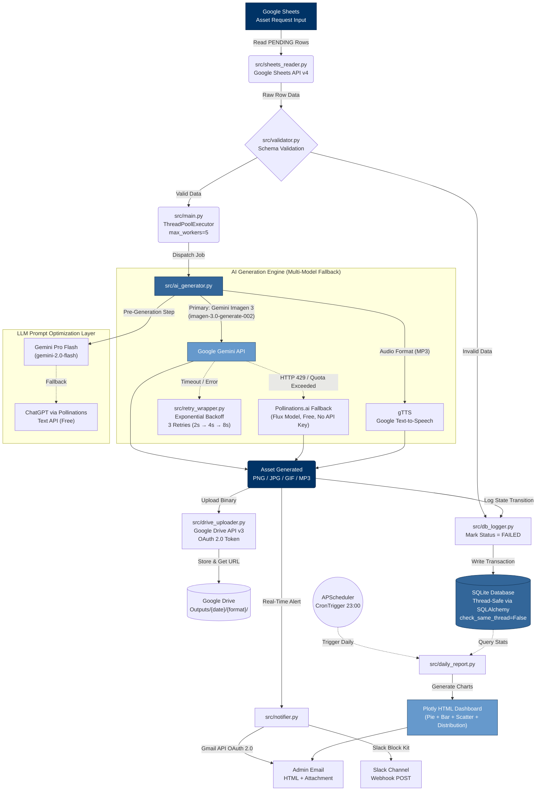
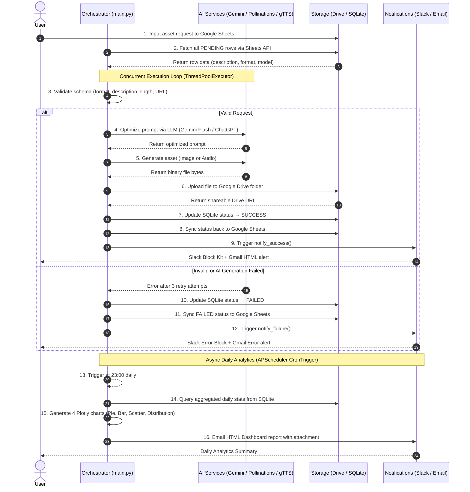

<div align="center">

# 🎨 AI Asset Generation Automation Pipeline

### Production-Grade Multi-Model AI Content Generation with Cloud-Native Orchestration

<p align="center">
  
  
  
  
  
  
  
</p>

_An end-to-end, fault-tolerant automation pipeline that reads asset requests from Google Sheets, generates images/audio via multi-model AI (Gemini Imagen 3 + Pollinations.ai + gTTS), uploads results to Google Drive, logs state to SQLite, and delivers real-time alerts via Slack Webhooks & Gmail OAuth 2.0 — all orchestrated through a multi-threaded Python pipeline with exponential backoff retry logic._

**Built by:** [Daniel Huynh](https://github.com/danielhuynh-04) • [LinkedIn](https://linkedin.com/in/le-thanh-hai-huynh-8353913a1) • [Kaggle](https://kaggle.com/lthanhhihunh)

</div>

---

## 🏆 Key Technical Highlights

| Capability | Implementation |
|:---|:---|
| **Multi-Model AI Orchestration** | Gemini Imagen 3 (Primary) → Pollinations.ai Flux (Fallback) → gTTS (Audio) |
| **LLM-Powered Prompt Optimization** | Gemini Pro Flash auto-rewrites user descriptions into professional prompts before generation |
| **Concurrent Processing** | `ThreadPoolExecutor(max_workers=5)` for parallel API calls & uploads |
| **Resilient Retry Logic** | Exponential Backoff with 3 retries, automatic Gemini→Pollinations failover on HTTP 429 |
| **Zero-Crash Architecture** | Every exception is caught, logged to SQLite, and synced back to Google Sheets as FAILED |
| **Enterprise Security** | Gmail API via **OAuth 2.0 Web Consent** (no SMTP/App Passwords), scoped Drive tokens |
| **Automated Daily Analytics** | APScheduler triggers Plotly HTML dashboards at 23:00 daily, emailed to admin |
| **Idempotent Pipeline** | Resume-safe — only processes rows with status ≠ DONE, prevents duplicate generation |

---

## 🏗️ System Architecture



---

## 🔄 Business Process Flow (BPMN Sequence)



---

## 🧩 Module Architecture

```text
AI-Asset-Generation-Automation-Pipeline/
│
├── src/                              # Core Pipeline Modules
│   ├── main.py                       # ⚙️  Pipeline Orchestrator (ThreadPoolExecutor, argparse CLI)
│   ├── sheets_reader.py              # 📊 Google Sheets API v4 Ingestion (read PENDING rows)
│   ├── validator.py                  # ✅ Input Schema Validation (format, URL, description length)
│   ├── ai_generator.py              # 🤖 Multi-Model AI Dispatcher (Gemini Imagen 3 + Pollinations + gTTS)
│   ├── retry_wrapper.py             # 🔄 Exponential Backoff Retry Decorator (configurable retries & delay)
│   ├── drive_uploader.py            # ☁️  Google Drive API v3 Upload (OAuth 2.0 scoped tokens)
│   ├── db_logger.py                 # 💾 SQLAlchemy ORM State Machine (thread-safe SQLite transactions)
│   ├── notifier.py                  # 📢 Slack Webhook + Gmail API OAuth 2.0 Notifications
│   └── daily_report.py              # 📈 Plotly Analytics Dashboard + APScheduler CronTrigger
│
├── prompt_engineering/               # Prompt Engineering Research & Iterations
│   ├── PROMPT_ENGINEERING_REPORT_EN.md   # Full English prompt engineering methodology report
│   ├── prompt_engineering_report.md      # Vietnamese version
│   └── iterations/                       # V1 → V2 → V3 prompt iteration samples per asset type
│
├── tests/                            # Automated Test Suite (pytest)
│   ├── conftest.py                   # Shared fixtures
│   ├── test_validator.py             # Input validation edge cases (format, URL, description)
│   └── test_db_logger.py            # Database state machine transitions
│
├── database/                         # Database Schema & ERD
├── docs/                             # Setup Guide & System Design
├── .env.example                      # Environment variable template
├── requirements.txt                  # Python dependencies
└── README.md                         # This documentation
```

---

## 🛠️ Full Technology Stack

| Category | Technologies |
|:---|:---|
| **Core Language** | Python 3.10+, SQL |
| **AI / ML Models** | Google Gemini Imagen 3 (`imagen-3.0-generate-002`), Gemini Pro Flash (`gemini-2.0-flash`), Pollinations.ai (Flux), gTTS |
| **Google Cloud Platform** | Sheets API v4, Drive API v3, Generative Language API, Gmail API, OAuth 2.0 Web Consent, Service Accounts |
| **Concurrency** | `concurrent.futures.ThreadPoolExecutor` (5 workers), thread-safe SQLite via `check_same_thread=False` |
| **Persistence** | SQLite + SQLAlchemy ORM (Job State Machine: PENDING → RUNNING → SUCCESS / FAILED) |
| **Notifications** | Slack Incoming Webhooks (Block Kit JSON), Gmail API OAuth 2.0 (HTML emails + attachments) |
| **Analytics** | Plotly (Pie, Bar, Scatter, Distribution charts), APScheduler (CronTrigger daily at 23:00) |
| **Resilience** | Custom `@retry` decorator with Exponential Backoff (2ˢ delay, 3 max retries), Multi-Model Fallback Chain |
| **Security** | OAuth 2.0 scoped tokens (Least Privilege), zero hardcoded credentials, `.env` isolation |
| **Testing** | pytest (validator + db_logger coverage) |

---

## 🚀 Quick Start

### 1. Clone & Setup
```bash
git clone https://github.com/danielhuynh-04/AI-Asset-Generation-Automation-Pipeline
cd AI-Asset-Generation-Automation-Pipeline
python -m venv .venv
.venv\Scripts\activate       # Windows
pip install -r requirements.txt
```

### 2. Google Cloud Configuration
> **Detailed guide:** [`docs/SETUP_GUIDE.md`](docs/SETUP_GUIDE.md)

1. Create a [Google Cloud Project](https://console.cloud.google.com) → Enable Sheets API, Drive API, Generative Language API, Gmail API
2. Create Service Account → download JSON → save as `credentials.json` in project root
3. Get [Gemini API Key](https://aistudio.google.com/app/apikey)
4. Create a Google Sheet, share with the service account email, copy Sheet ID
5. Create [Slack Webhook](https://api.slack.com/messaging/webhooks) → copy URL
6. Create [OAuth Client ID](https://console.cloud.google.com/apis/credentials/oauthclient) → download `client_secret.json`

### 3. Configure Environment
```bash
cp .env.example .env
# Fill in: GEMINI_API_KEY, GOOGLE_SHEET_ID, GOOGLE_DRIVE_FOLDER_ID, SLACK_WEBHOOK_URL
```

### 4. Run Pipeline
```bash
cd src
python main.py                       # Full pipeline execution
python main.py --report-only         # Generate daily analytics report only
python main.py --with-scheduler      # Pipeline + auto-report at 23:00
python daily_report.py --run-now     # Immediate report generation
python -m pytest tests/ -v           # Run test suite
```

---

## 📊 Job State Machine

```
PENDING → RUNNING → SUCCESS (asset generated, uploaded, notified)
                  ↘
             RETRY (1→3) → SUCCESS
                         ↘ FAILED (retries exhausted, logged & notified)

PENDING → FAILED (validation error — blocked before AI generation)
```

---

## 🤖 AI Model Specifications

| Model | Purpose | Tier |
|:---|:---|:---|
| **Gemini Imagen 3** (`imagen-3.0-generate-002`) | High-quality image generation (primary) | Free: 10 images/day |
| **Pollinations.ai** (Flux) | Free fallback image generation (no API key) | Unlimited |
| **Gemini Pro Flash** (`gemini-2.0-flash`) | LLM prompt optimization before generation | Free: 1,500 req/day |
| **ChatGPT** (via Pollinations Text API) | Fallback prompt optimizer | Free, unlimited |
| **gTTS** (Google Text-to-Speech) | Audio asset generation (MP3) | Free, unlimited |

---

## 📂 Output Structure

```
outputs/
└── 2026-07-14/
    ├── PNG/
    │   ├── job_0001_1720900000.png
    │   └── job_0003_1720900050.png
    ├── JPG/
    │   └── job_0002_1720900020.jpg
    └── MP3/
        └── job_0004_1720900080.mp3

Google Drive Mirror: Outputs/{date}/{format}/{filename}
```

---

## 🔮 Future Improvements

| Current Limitation | Planned Upgrade |
|:---|:---|
| Gemini free tier (10 images/day) | Queue worker + paid API tier or self-hosted Stable Diffusion |
| APScheduler in-process (stops with script) | Celery + Redis distributed task queue |
| SQLite single-file database | PostgreSQL for multi-user, high-volume production |
| No prompt deduplication | SHA-256 prompt hash cache layer to skip re-generation |
| Pollinations public API (no SLA) | Self-hosted inference via HuggingFace Inference Endpoints |

---

<div align="center">
  <b>Daniel Huynh (Huynh Le Thanh Hai)</b><br>
  AI/Data Engineering • Ho Chi Minh City Open University (High-Quality Program)<br>
  <a href="mailto:Haiworkai@gmail.com">Haiworkai@gmail.com</a> • <a href="https://linkedin.com/in/le-thanh-hai-huynh-8353913a1">LinkedIn</a> • <a href="https://kaggle.com/lthanhhihunh">Kaggle</a>
</div>
